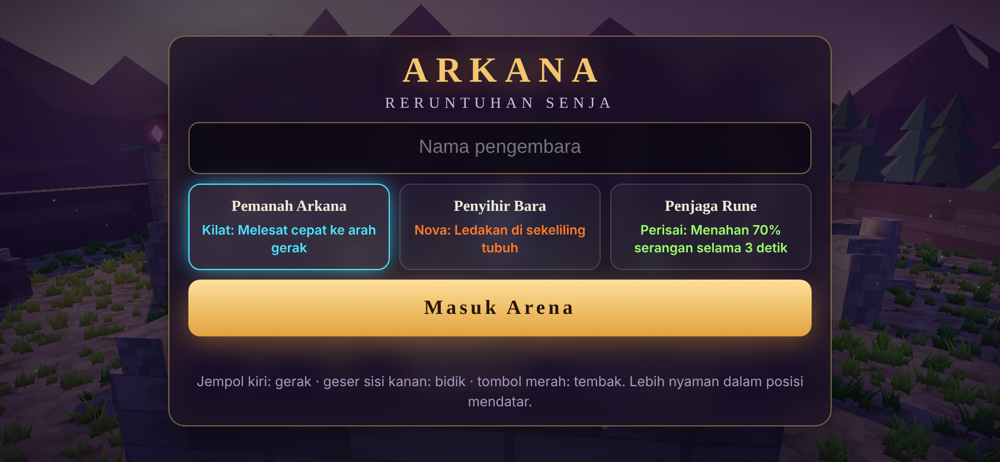

# Arkana: Reruntuhan Senja

Arena shooter PvP (deathmatch) berlatar fantasi untuk browser HP dan desktop.
Multiplayer online dengan server otoritatif; room diisi bot bila pemain sedikit.

## Menjalankan

```bash
cd game
npm install        # sekaligus mem-build klien ke client/dist/bundle.js
npm start          # http://localhost:8080  (ubah port dengan PORT=xxxx)
```

Buka alamat itu di HP (satu jaringan Wi-Fi: `http://IP-komputer:8080`) atau di desktop.

## Menaruh online

Game butuh server Node yang hidup terus (WebSocket), jadi GitHub Pages saja tidak cukup.
Di layanan seperti Render, Railway, atau Fly.io:

- Root directory: `game`
- Build command: `npm install`
- Start command: `npm start`
- Health check: `/health`

Server yang sama menyajikan klien dan WebSocket (`/ws`). Jika klien disajikan dari tempat
lain, arahkan ke server dengan `?server=wss://alamat-server/ws`.

## Menaruh di VPS dengan Docker

```bash
git clone -b claude/practical-sagan-uin0e8 https://github.com/alensgg06/siqdist.git
cd siqdist/game
docker compose up -d --build
docker compose ps          # status harus "healthy"
```

Game lalu tersedia di `http://IP-VPS:18080`. Port host diatur lewat `ARKANA_PORT` di file
`.env` (bawaan 18080); ganti bila sudah dipakai container lain. Untuk akses langsung dari
luar, buka port itu di firewall (mis. `ufw allow 18080/tcp`). Lewat Cloudflare Tunnel
port ini tidak perlu dibuka.

Memperbarui setelah ada perubahan kode: `git pull && docker compose up -d --build`.
Melihat log: `docker compose logs -f arkana`.

### Main dari luar rumah lewat Cloudflare Tunnel

Server di jaringan rumah (alamat `192.168.x.x`) tidak terjangkau dari internet. Tunnel
membuat sambungan keluar dari server ke Cloudflare, jadi tidak perlu membuka port router,
dan alamatnya langsung HTTPS.

**Tunnel cepat** (tanpa akun, untuk mencoba):

```bash
docker compose --profile quick up -d --build
docker compose logs tunnel-quick | grep trycloudflare.com
```

Alamat `https://....trycloudflare.com` yang muncul bisa langsung dibagikan. Alamat ini
berganti setiap container tunnel dimulai ulang (termasuk saat server reboot).

**Tunnel tetap** (alamat tidak berubah; butuh akun Cloudflare dan domain di sana):

1. Dasbor Cloudflare Zero Trust > Networks > Tunnels > buat tunnel jenis *Cloudflared*.
2. Salin token-nya ke file `.env`: `cp .env.example .env`, lalu isi `TUNNEL_TOKEN=`.
3. Di tab *Public Hostname* tunnel itu: pilih subdomain, service `HTTP`, URL `arkana:8080`.
4. `docker compose --profile tunnel up -d --build`

### HTTPS (disarankan bila punya domain)

Dengan reverse proxy yang sudah ada di VPS (Nginx Proxy Manager, Traefik, Caddy),
arahkan domain ke `arkana:8080` / `localhost:8080` dan **aktifkan dukungan WebSocket**.
Contoh Caddyfile, sertifikat diurus otomatis:

```
game.domainmu.com {
    reverse_proxy localhost:8080
}
```

## Aplikasi Android (APK)

Folder `android/` berisi pembungkus tipis: aplikasi layar penuh yang membuka game dari
server. APK tidak memuat game-nya, jadi server tetap harus menyala dan terjangkau dari HP.

```bash
ANDROID_HOME=/path/android-sdk ./android/build.sh http://ALAMAT-SERVER:8080
# hasil: android/build/Arkana.apk
```

Butuh JDK 17+ dan Android SDK (platform 34, build-tools 35.0.0). Alamat server tertanam
sebagai bawaan; pemain bisa menggantinya lewat tombol Kembali > "Ganti server".
Simpan file kunci tanda tangan (`~/.arkana/arkana.jks`): versi baru hanya bisa menimpa
versi lama bila ditandatangani kunci yang sama.

## Bermain bersama teman

- **Room privat**: di menu, *Buat room privat*. Kode 4 huruf muncul di atas layar; ketuk untuk
  menyalin tautan `…/?room=KODE`, atau sebutkan kodenya. Teman mengisi kode lalu *Gabung*.
  Room privat tidak pernah dimasuki pemain dari tombol *Masuk Arena*.
- **Latihan**: pemain baru otomatis masuk latihan bertutorial (5 langkah, bot boneka tidak
  menyerang). Bisa dilewati, dan bisa diulang dari *Latihan dan tutorial* di menu.

## Mode dan rune

- **Deathmatch** (semua room publik): pertama mencapai 20 kill, atau skor tertinggi setelah 5 menit.
- **Rebut Altar** (pilih saat membuat room privat): berdiri sendirian di lingkaran altar memberi
  1 poin per detik; dua pemain atau lebih di dalam berarti diperebutkan dan tidak ada yang dapat
  poin. Pertama mencapai 60 poin menang. Warna lingkaran: emas = kamu, merah = lawan, ungu = diperebutkan.
- **Rune** muncul di empat titik peta dan kembali 25 detik setelah diambil:
  Rune Amarah (merah) damage +50% selama 10 detik, Rune Angin (biru) kecepatan +35% selama 10 detik.

## Kompensasi lag

Klien mengirim nomor tick dunia yang sedang ia tampilkan. Saat pemain menembak, server memutar
mundur posisi lawan ke tick itu (paling jauh 0,45 detik) dan menerbangkan peluru di sana, sehingga
peluru yang di layar mengenai lawan memang dihitung kena. Uji `test/modes.test.js` mengukurnya
dengan latensi buatan 150 ms satu arah pada lawan yang bergerak menyamping.

## Catatan pertandingan

Setiap ronde publik atau privat yang selesai dicatat satu baris di `data/matches.jsonl`
(nama, kelas, kill, gugur, damage, level, rata-rata ping dan fps per pemain, siapa yang keluar
di tengah). Ronde latihan tidak dicatat. Ringkasan keseimbangan kelas:

```bash
docker compose exec arkana node tools/stats.js     # di server Docker
npm run stats                                       # tanpa Docker
```

## Kontrol

| | HP | Desktop |
|---|---|---|
| Gerak | jempol kiri (joystick muncul di titik sentuh) | WASD |
| Bidik | geser sisi kanan layar, atau geser sambil menahan tombol tembak | mouse |
| Tembak | tombol merah | klik kiri |
| Skill | tombol ungu | Spasi / klik kanan |
| Papan skor | ketuk skor di atas | Tab |

Di HP, bantuan bidik dan tembak otomatis aktif secara bawaan; bisa dimatikan di menu ☰.

## Aturan

- Deathmatch bebas: pemenang adalah yang pertama mencapai 20 kill, atau skor tertinggi setelah 5 menit.
- Tiga kelas: Pemanah Arkana (cepat, jarak jauh), Penyihir Bara (ledakan area), Penjaga Rune (sebaran jarak dekat, tubuh kuat).
- XP dari damage dan kill menaikkan level (maks 5) selama satu ronde: +8% damage dan +12 HP per level.
- Bola hijau memulihkan 40 HP. HP pulih sendiri setelah 5 detik tanpa terkena serangan.

## Struktur

```
shared/   konstanta, peta, dan fisika yang dipakai klien DAN server
server/   server otoritatif (gerak, proyektil, damage, skor, bot)
client/   klien Three.js: dunia, karakter, efek, kontrol sentuh, HUD
test/     uji integrasi jaringan tanpa grafis
```

## Uji

```bash
PORT=8099 node server/server.js &
WS_URL=ws://localhost:8099/ws npm test
# uji akhir ronde:
PORT=8098 KILL_LIMIT=1 END_TIME=2 node server/server.js &
WS_URL=ws://localhost:8098/ws EXPECT_END=1 npm test
```

## Batasan yang diketahui

- Tembakan adalah proyektil yang disimulasikan server, tanpa kompensasi lag: pada ping tinggi,
  bidik sedikit di depan lawan yang bergerak.
- Semua aset prosedural (tanpa model/animasi buatan seniman).
- Pesan jaringan memakai JSON, belum biner.

## Tangkapan layar



