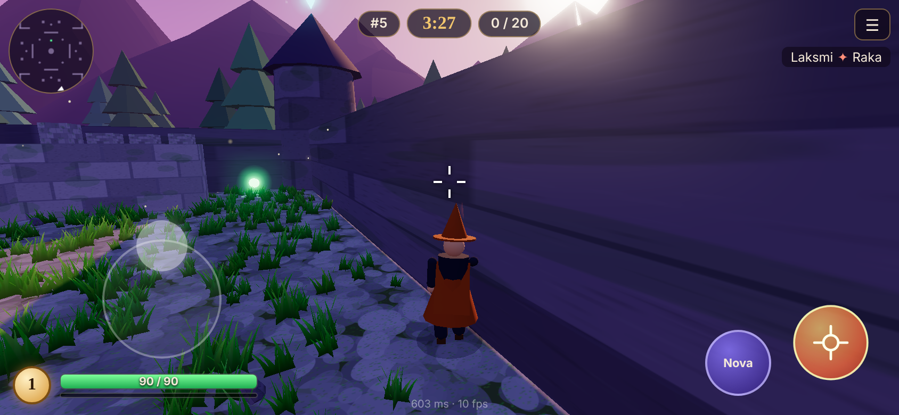

# Arkana: Reruntuhan Senja

Arena shooter PvP (deathmatch) berlatar fantasi untuk browser HP dan desktop.
Multiplayer online dengan server otoritatif; room diisi bot bila pemain sedikit.

## Menjalankan

```bash
cd game
npm install        # sekaligus mem-build klien ke client/dist/bundle.js
npm start          # http://localhost:8080  (ubah port dengan PORT=xxxx)
```

Buka alamat itu di HP (satu jaringan Wi-Fi: `http://IP-komputer:8080`) atau di desktop.

## Menaruh online

Game butuh server Node yang hidup terus (WebSocket), jadi GitHub Pages saja tidak cukup.
Di layanan seperti Render, Railway, atau Fly.io:

- Root directory: `game`
- Build command: `npm install`
- Start command: `npm start`
- Health check: `/health`

Server yang sama menyajikan klien dan WebSocket (`/ws`); klien selalu tersambung ke server asal halamannya.

## Menaruh di VPS dengan Docker

```bash
git clone -b claude/practical-sagan-uin0e8 https://github.com/alensgg06/siqdist.git
cd siqdist/game
docker compose up -d --build
docker compose ps          # status harus "healthy"
```

Game lalu tersedia di `http://IP-VPS:18080`. Port host diatur lewat `ARKANA_PORT` di file
`.env` (bawaan 18080); ganti bila sudah dipakai container lain. Untuk akses langsung dari
luar, buka port itu di firewall (mis. `ufw allow 18080/tcp`). Lewat Cloudflare Tunnel
port ini tidak perlu dibuka.

Memperbarui setelah ada perubahan kode: `git pull && docker compose up -d --build`.
Melihat log: `docker compose logs -f arkana`.

### Main dari luar rumah lewat Cloudflare Tunnel

Server di jaringan rumah (alamat `192.168.x.x`) tidak terjangkau dari internet. Tunnel
membuat sambungan keluar dari server ke Cloudflare, jadi tidak perlu membuka port router,
dan alamatnya langsung HTTPS.

**Tunnel cepat** (tanpa akun, untuk mencoba):

```bash
docker compose --profile quick up -d --build
docker compose logs tunnel-quick | grep trycloudflare.com
```

Alamat `https://....trycloudflare.com` yang muncul bisa langsung dibagikan. Alamat ini
berganti setiap container tunnel dimulai ulang (termasuk saat server reboot).

**Tunnel tetap** (alamat tidak berubah; butuh akun Cloudflare dan domain di sana):

1. Dasbor Cloudflare Zero Trust > Networks > Tunnels > buat tunnel jenis *Cloudflared*.
2. Salin token-nya ke file `.env`: `cp .env.example .env`, lalu isi `TUNNEL_TOKEN=`.
3. Di tab *Public Hostname* tunnel itu: pilih subdomain, service `HTTP`, URL `arkana:8080`.
4. `docker compose --profile tunnel up -d --build`

### HTTPS (disarankan bila punya domain)

Dengan reverse proxy yang sudah ada di VPS (Nginx Proxy Manager, Traefik, Caddy),
arahkan domain ke `arkana:8080` / `localhost:8080` dan **aktifkan dukungan WebSocket**.
Contoh Caddyfile, sertifikat diurus otomatis:

```
game.domainmu.com {
    reverse_proxy localhost:8080
}
```

## Aplikasi Android (APK)

Folder `android/` berisi pembungkus tipis: aplikasi layar penuh yang membuka game dari
server. APK tidak memuat game-nya, jadi server tetap harus menyala dan terjangkau dari HP.

```bash
ANDROID_HOME=/path/android-sdk ./android/build.sh http://ALAMAT-SERVER:8080
# hasil: android/build/Arkana.apk
```

Butuh JDK 17+ dan Android SDK (platform 34, build-tools 35.0.0). Alamat server tertanam
dan pemain tidak bisa menggantinya; alamat baru berarti APK baru.
Simpan file kunci tanda tangan (`~/.arkana/arkana.jks`): versi baru hanya bisa menimpa
versi lama bila ditandatangani kunci yang sama.

## iPhone dan pasang tanpa APK

Game ini halaman web, jadi iPhone memainkannya lewat Safari tanpa aplikasi dari App Store. Supaya terasa seperti aplikasi: buka alamat game di Safari, ketuk **Bagikan**, pilih **Tambah ke Layar Utama**. Ikon Arkana muncul di layar utama dan game terbuka layar penuh. Halaman menampilkan petunjuk ini sendiri di iPhone; di Chrome Android ia menawarkan tombol **Pasang** bila peramban mengizinkan. Petunjuk tidak muncul di dalam APK, di desktop, atau setelah ditutup.

Catatan iPhone: getar tidak didukung Safari; layar tidak bisa dikunci mendatar (putar HP sendiri); suara mengikuti saklar senyap; aplikasi dari layar utama menyimpan datanya terpisah dari Safari, jadi masuk akun sekali lagi di sana. Ikon dibuat dengan `python3 tools/icons.py`.

## Bermain bersama teman

Menu dirancang supaya pemain saling bertemu:

- **Sedang bermain** menampilkan room yang berisi teman (mode, nama, jumlah) dengan tombol Gabung. Hanya terlihat oleh yang sudah masuk akun; room latihan tidak ditampilkan.
- **Main Bersama** membawa pemain ke event yang sedang berjalan; bila tidak ada, ke room teman yang paling ramai; bila semuanya kosong, membuat room baru dengan mode yang dipilih.
- Tiga mode utama di depan (Bertahan Bersama, Tim, Perburuan Raja); Deathmatch, Rebut Altar, dan Lawan Bot ada di balik "Mode lain".

- **Room privat**: di menu, *Buat room privat*. Kode 4 huruf muncul di atas layar; ketuk untuk
  menyalin tautan `…/?room=KODE`, atau sebutkan kodenya. Teman mengisi kode lalu *Gabung*.
  Room privat tidak pernah dimasuki pemain dari tombol *Masuk Arena*.
- **Latihan**: pemain baru otomatis masuk latihan bertutorial (5 langkah, bot boneka tidak
  menyerang). Bisa dilewati, dan bisa diulang dari *Latihan dan tutorial* di menu.

## Mode dan rune

- **Deathmatch** (semua room publik): pertama mencapai 20 kill, atau skor tertinggi setelah 5 menit.
- **Rebut Altar** (pilih saat membuat room privat): berdiri sendirian di lingkaran altar memberi
  1 poin per detik; dua pemain atau lebih di dalam berarti diperebutkan dan tidak ada yang dapat
  poin. Pertama mencapai 60 poin menang. Warna lingkaran: emas = kamu, merah = lawan, ungu = diperebutkan.
- **Tim** (room privat): dua regu, Fajar (emas) dan Senja (ungu), dibagi rata dan diisi bot sampai
  3 lawan 3. Tanpa tembak kawan. Regu pertama mencapai 30 kill menang.
- **Lawan Bot** (room privat): semua teman satu regu melawan bot; jumlah bot = jumlah teman + 2
  (minimal 3).
- **Rune** muncul di empat titik peta dan kembali 25 detik setelah diambil:
  Rune Amarah (merah) damage +50% selama 10 detik, Rune Angin (biru) kecepatan +35% selama 10 detik.

## Bertahan Bersama

Mode kerja sama (room privat): semua teman melawan gelombang monster yang makin kuat.

| Monster | Sifat |
|---|---|
| Hantu Rawa | cepat mendekat, menyerang dari dekat; lebih lambat dari semua kelas sehingga bisa dihindari |
| Dukun Bayang | menjaga jarak dan menembakkan bola gelap (sejak gelombang 2) |
| Golem Batu | bos tiap 5 gelombang: pukulan berat dan hentakan tanah; HP menyesuaikan jumlah pemain |

Gelombang 1-3 adalah pemanasan (sedikit monster, serangan lebih lemah). Monster memberi aba-aba
0,45 detik sebelum memukul, dan panah merah di sekitar bidikan menunjuk monster di luar layar.
Bila pemain kurang dari 3, bot sekutu ikut bertarung.

- **Berkah**: setelah tiap gelombang, pilih 1 dari 3 peningkatan acak (Tajam, Cepat, Vampir, Kokoh,
  Lincah, Fokus, Amarah, Ganda, Ledak, Pulih). Bertahan sampai permainan berakhir.
- **Tumbang**: satu nyawa cadangan per gelombang (bangkit sendiri setelah 4 detik); setelah itu
  rekan bisa menolong dengan berdiri di dekatmu 3 detik.
- **Titik simpan**: setelah kalah, ronde berikutnya lanjut dari gelombang kelipatan 5 terakhir
  yang diselesaikan, dengan beberapa berkah acak sebagai bekal.

Pemain yang tumbang juga bangkit saat gelombang selesai; semua pulih penuh di antara gelombang.
Permainan berakhir bila semua tumbang bersamaan. Bertahan melewati gelombang 10 dihitung menang.
Tingkat bot (Mudah/Normal/Sulit) mengatur kekuatan monster.

## Akun

Pemain wajib masuk dengan akun sebelum bermain; yang belum punya mendaftar dulu di halaman yang sama (nama pengguna 3-14 karakter dan kata sandi minimal 8 karakter). Nama pengguna menjadi nama tampilan, dan statistik, jubah, serta pencapaian mengikuti akun di perangkat mana pun. Saat mendaftar, statistik yang sudah ada di perangkat itu ikut ke akun pertama yang dibuat di sana.

- Kata sandi disimpan sebagai hasil scrypt bergaram di `data/accounts.json`, token sesi sebagai SHA-256; keduanya tidak pernah tersimpan polos. Sesi berlaku 30 hari.
- Percobaan masuk dibatasi 8 kali per 10 menit, per nama dan per alamat.
- Satu akun pemain hanya bisa masuk di satu perangkat, akun pengelola di dua. Masuk di perangkat baru mengeluarkan perangkat tertua, termasuk dari arena.
- Tidak ada pemulihan lewat email. Lupa kata sandi direset oleh pengelola server:

```bash
docker compose exec arkana node tools/akun.js daftar
docker compose exec arkana node tools/akun.js sandi <nama> <kata-sandi-baru>
docker compose exec arkana node tools/akun.js hapus <nama>
```

- Isi `ARKANA_INVITE` di `.env` supaya hanya yang tahu kode itu bisa mendaftar; kosong berarti pendaftaran terbuka.
- Lewat alamat `https://` kata sandi terenkripsi di perjalanan. Lewat `http://IP:port` di jaringan rumah tidak, jadi pakai alamat https untuk mendaftar dan masuk.
- `ARKANA_AUTH=off` mematikan kewajiban akun; hanya untuk uji dan pengembangan.

## Halaman admin

Buka `/admin.html` di alamat game dari browser, lalu masuk dengan akun pengelola. Menu di kolom kiri membagi halaman menjadi lima kelompok (Arena, Akun, Event, Server, Email), masing-masing dengan ubin ringkasannya sendiri; di layar HP menu menjadi baris di atas. Isinya: ringkasan (pemain di arena, jumlah akun, event berjalan), room yang sedang dimainkan, event (mulai sekarang, jadwalkan, hentikan, batalkan), akun (ganti kata sandi, atur email, keluarkan dari arena, blokir, hapus), ronde terakhir, dan email percobaan.

Bagian **Beban server** menampilkan kapasitas terpasang dan pemakaian saat ini: CPU server game (dari satu inti), CPU seluruh mesin, waktu hitung per tick terhadap anggarannya (33,3 ms), memori container dan mesin, disk folder data, serta grafik 10 menit terakhir. Waktu hitung per tick adalah ukuran paling langsung: selama jauh di bawah anggaran, server tidak menjadi penyebab lag. Kartu grafis tidak ditampilkan karena server game tidak memakainya.

Menyiapkan pengelola:

```bash
docker compose exec arkana node tools/akun.js buat <nama> <kata-sandi>   # buat akun pengelola
# lalu di .env:  ARKANA_ADMINS=<nama>     (beberapa nama dipisah koma)
docker compose up -d
```

- Nama di `ARKANA_ADMINS` tidak bisa didaftarkan dari halaman umum, supaya tidak direbut orang; akunnya dibuat lewat perintah di atas. Bila `ARKANA_ADMINS` kosong, halaman admin mati untuk semua orang.
- Setiap tindakan dicatat di `data/admin.log` (siapa, apa, kapan; tanpa kata sandi).
- Akun pengelola tidak bisa dihapus atau diblokir dari halaman ini; itu hanya lewat `tools/akun.js` di server.

## Email (lupa kata sandi)

Server tidak mengirim email sendiri; ia menitipkannya ke SMTP penyedia email (Gmail, atau layanan email transaksional). Mengirim langsung dari internet rumah hampir pasti ditolak atau masuk spam, jadi itu sengaja tidak dibuat.

Isi di `.env` di server, lalu jalankan ulang container:

```
SMTP_HOST=smtp.penyedia.com
SMTP_PORT=587
SMTP_USER=...
SMTP_PASS=...            # rahasia: hanya di .env
SMTP_FROM=Arkana <alamat@domainmu>
```

Periksa dan coba:

```bash
docker compose exec arkana node tools/email.js cek
docker compose exec arkana node tools/email.js tes kamu@contoh.com
```

Saat pengirim email aktif: pendaftaran meminta email (satu email untuk satu akun), dan halaman masuk menampilkan "Lupa kata sandi?". Pemain memasukkan nama pengguna, menerima kode 6 angka (berlaku 15 menit, hangus setelah 5 tebakan salah), lalu membuat kata sandi baru. Akun yang dibuat sebelum email aktif belum punya email; isi dengan `node tools/akun.js email <nama> <alamat>`. Bila `SMTP_HOST` kosong, semua ini mati dan game berjalan seperti biasa.

## Event

Event adalah acara berjangka waktu yang kamu mulai sendiri. Selama event berjalan, menu menampilkan spanduk dengan hitung mundur dan tombol **Ikut event**; semua yang menekan tombol itu masuk ke room event yang sama (sampai penuh, lalu room berikutnya).

| Tipe | Isi | Target | Hadiah |
|---|---|---|---|
| `golem` (Malam Golem) | Bertahan Bersama, bos tiap 3 gelombang, dua Berkah tiap gelombang | Selesaikan gelombang 6 | jubah Batu Golem |
| `raja` (Perburuan Raja) | Satu pemain menjadi raja (HP 2,2 kali, 1 poin per detik); yang menumbangkannya merebut mahkota | Kumpulkan 45 poin sebagai raja | Jubah Mahkota |

Hadir di event tercatat (pencapaian Tamu Setia setelah 3 event). Skor terbaik tiap pemain masuk papan event, dan setelah event selesai menu menampilkan tiga besar selama 7 hari. Perburuan Raja juga bisa dimainkan kapan saja sebagai mode biasa lewat room privat, tanpa hadiah event.

**Event mingguan** mulai sendiri pada hari dan jam yang ditetapkan, tanpa perlu ditekan: atur di halaman admin (menu Event, Jadwal mingguan) atau dengan `node tools/event.js mingguan bergantian sabtu 20:00 120`. Tipe `bergantian` menukar Malam Golem dan Perburuan Raja tiap minggu. Menghentikan satu kejadian hanya melewati minggu itu.

Mengatur event (server membaca perubahan dalam sekitar 5 detik, tanpa restart):

```bash
docker compose exec arkana node tools/event.js mulai golem 60          # mulai sekarang, 60 menit
docker compose exec arkana node tools/event.js mulai raja 90 Malam Minggu
docker compose exec arkana node tools/event.js jadwal raja 2026-11-21T20:00 2026-11-21T22:00
docker compose exec arkana node tools/event.js daftar
docker compose exec arkana node tools/event.js hentikan
```

Waktu tanpa zona dibaca sebagai WIB. Jadwal disimpan di `data/events.json` (ikut volume data, jadi bertahan saat container dibangun ulang) dan boleh disunting tangan:

```json
[{ "id": "golem-sabtu", "tipe": "golem", "mulai": "2026-11-21T20:00", "selesai": "2026-11-21T23:00", "nama": "Malam Golem", "target": 6 }]
```

`nama`, `target`, dan `aturan` (`bossRush`, `doublePerk`) opsional. Entri yang salah dilewati dan alasannya ditulis ke log; `node tools/event.js cek` memeriksanya.

## Selama ronde

Pemain yang tidak bergerak dan tidak memakai jurus selama 30 menit dikeluarkan dari arena dengan pesan di menu; akunnya tetap masuk dan ia bisa langsung bergabung lagi. Menembak dan arah bidik tidak dihitung sebagai aktivitas, karena tembak otomatis dan bantuan bidik bisa menghasilkannya sendiri.

- **Buronan**: pemimpin kill (minimal 3, unggul 2) bermahkota dan tampil di peta mini;
  menumbangkannya memberi +200 XP.
- **Kejadian** tiap 90 detik: Gerhana (gelap, bot hanya melihat dekat), Hujan Rune, Cawan Emas.
- **Jurus pamungkas** terisi dari damage dan kill: Hujan Panah, Meteor, Benteng Rune
  (tombol emas di HP, tombol Q di desktop).
- **Tantangan harian**: 3 tantangan yang sama untuk semua pemain, berganti tiap hari (WIB);
  menyelesaikannya membuka jubah Bintang Fajar dan Bayangan Malam.

## Tambahan D2

- **Haji Toriq** (kelas keempat): skill Doa memulihkan 35 HP untuk diri dan rekan di dekatnya;
  jurus Cahaya Fajar memulihkan rekan sepenuhnya dan membangkitkan yang tumbang.
- **Monster baru**: Penyihir Es (memperlambat, sejak gelombang 4), Ratu Laba-laba (bos gelombang
  10, memanggil anak laba-laba). Golem Batu tetap bos gelombang 5 dan 15.
- **Tong meledak** di Pelabuhan Bulan: ditembak, meledak melukai lawan di sekitarnya (dan penembak
  bila terlalu dekat), muncul lagi setelah 20 detik.
- **Isyarat cepat** (tombol `!`): Tolong!, Ke sini!, Bagus!, tampil ke rekan dan di peta mini.
- **Menonton rekan** saat tumbang di mode tim dan Bertahan Bersama.
- **Kembali ke room terakhir** dari menu dengan satu tombol.
- **Mode akhir pekan** (room publik, Sabtu-Minggu WIB, bergilir tiap minggu): Raksasa, Hujan
  Meteor, Tembakan Maut, Hanya Penyihir.
- **Peringkat Bertahan mingguan** dan **pencapaian** di panel Peringkat.

## Peta

Arena berukuran 116 x 116 langkah (`ARENA = 58` di `shared/config.js`, semula 44). Tata letak lama digeser keluar sebanding dan lingkar luarnya diberi perlindungan tambahan. Bila ukuran atau letak penghalang diubah, jalankan `node tools/bake.js` supaya cahaya lantai ikut diperbarui.

- **Reruntuhan Senja**: reruntuhan batu di bawah langit senja, altar kristal di tengah.
- **Pelabuhan Bulan**: dermaga kayu di malam purnama, menara lonceng di tengah, gudang, peti,
  tiang kapal berlentera, air dan mercusuar di kejauhan.

Room publik berganti peta setiap ronde. Pembuat room privat memilih *Peta bergantian*,
*Reruntuhan*, atau *Pelabuhan*.

## Statistik, peringkat, dan jubah

Setiap HP atau browser mendapat id acak (tanpa akun) yang hanya dikirim ke server. Kill, gugur,
kemenangan, dan jumlah ronde disimpan di `data/players.json` (volume Docker yang sama dengan
catatan pertandingan). Menu *Peringkat dan jubah* menampilkan 10 besar minggu ini, statistikmu,
dan jubah yang terbuka:

| Jubah | Syarat |
|---|---|
| Zamrud | 5 ronde selesai |
| Ungu Senja | 25 kill |
| Perak Bulan | 3 kemenangan |
| Darah Naga | 100 kill |
| Emas Raja | 10 kemenangan |

Server memeriksa syaratnya sendiri, jadi jubah terkunci tidak bisa dipakai dengan mengubah klien.
Catatan: id tersimpan di browser/aplikasi; menghapus data aplikasi berarti mulai dari nol.

## Kompensasi lag

Klien mengirim nomor tick dunia yang sedang ia tampilkan. Saat pemain menembak, server memutar
mundur posisi lawan ke tick itu (paling jauh 0,45 detik) dan menerbangkan peluru di sana, sehingga
peluru yang di layar mengenai lawan memang dihitung kena. Uji `test/modes.test.js` mengukurnya
dengan latensi buatan 150 ms satu arah pada lawan yang bergerak menyamping.

## Catatan pertandingan

Setiap ronde publik atau privat yang selesai dicatat satu baris di `data/matches.jsonl`
(nama, kelas, kill, gugur, damage, level, rata-rata ping dan fps per pemain, siapa yang keluar
di tengah). Ronde latihan tidak dicatat. Ringkasan keseimbangan kelas:

```bash
docker compose exec arkana node tools/stats.js     # di server Docker
npm run stats                                       # tanpa Docker
```

## Grafis

Gambar dirender di perangkat pemain (WebGL), bukan di server. Tiga tingkat kualitas di menu Pengaturan:

| Tingkat | Isi |
|---|---|
| Rendah | bayangan bangunan dari panggangan (karakter tanpa bayangan), tanpa efek layar, tanpa tekstur timbul dan pantulan langit |
| Sedang | bayangan, cahaya berpendar, gradasi warna, tekstur timbul pada batu, tanah, dan kayu, pantulan langit |
| Tinggi | semua di atas, ditambah penghalus tepi, bayangan lebih tajam, dan resolusi penuh |

Kualitas turun sendiri bila fps di bawah 27 selama beberapa detik, kecuali pemain memilih tingkatnya sendiri. Tekstur timbul, pantulan langit, dan cahaya tepi karakter dibuat di perangkat dari aset yang sama (`client/src/gfx.js`), jadi ukuran unduhan hampir tidak bertambah.

## Cahaya lantai yang dipanggang

`node tools/bake.js` menghitung, untuk tiap peta, gelap-sudut di sekitar penghalang dan bayangan matahari atau bulan di lantai, lalu menyimpannya sebagai gambar di `client/bake/` (ikut di-commit). Game menempelkannya ke lantai dengan satu pembacaan tekstur: gelap-sudut tampil di semua tingkat kualitas, dan di tingkat Rendah, yang tidak punya bayangan langsung, lantai memakai bayangan panggangan. Jalankan ulang perintah itu bila letak penghalang di `shared/config.js` berubah.

## Tekstur dari GPU (opsional)

Tekstur batu, tanah, papan dermaga, dan peti bisa diganti versi resolusi tinggi yang dibuat model gambar (SDXL) di GPU NVIDIA milik server. Ini proses sekali jalan, bukan bagian dari server game; game tetap digambar di perangkat pemain.

```bash
docker compose --profile gfx build gfx
docker compose --profile gfx run --rm gfx                 # semua tekstur
GFX_ONLY=stone GFX_SEED=5 docker compose --profile gfx run --rm gfx   # ulang satu tekstur dengan hasil lain
```

- Butuh runtime `nvidia` di Docker (`docker info | grep -i runtime`) dan sekitar 6 GB memori GPU bebas. Jalan pertama mengunduh image dan model, total belasan GB; setelahnya tersimpan di volume `arkana-hf`.
- Hasil masuk ke `assets/` di volume data dan langsung dipakai setelah halaman game dimuat ulang, tanpa membangun ulang container. Kualitas Rendah tidak mengunduhnya.
- Skrip melaporkan apakah tepi tiap tekstur menyambung; bila tidak, ulangi dengan `GFX_SEED` lain.
- Kembali ke tekstur bawaan: `docker compose exec -u root arkana rm -rf /app/data/assets`.

## Suara

Semua bunyi disintesis di perangkat pemain (`client/src/audio.js`), tanpa berkas audio. Tiap bunyi berlapis (hentakan, badan, ekor) dengan nada yang sedikit diacak, dan tembakan pemain lain diredam sesuai jarak. Buka `/suara.html` di server game untuk mendengar tiap bunyi tanpa bermain.

Musik latar juga disintesis: satu lagu tenang untuk halaman pembuka dan satu lagu berdenyut saat bermain, berganti dengan memudar. Volume musik dan efek diatur terpisah lewat penggeser di halaman pembuka dan di menu Pengaturan (0 = mati), dan tersimpan di perangkat. Di peramban, suara baru mulai setelah sentuhan pertama; di APK langsung saat dibuka. Suara berhenti saat aplikasi di latar belakang.

## Kontrol

| | HP | Desktop |
|---|---|---|
| Gerak | jempol kiri (joystick muncul di titik sentuh) | WASD |
| Bidik | geser sisi kanan layar, atau geser sambil menahan tombol tembak | mouse |
| Tembak | tombol merah | klik kiri (tahan); bila pointer lock ditolak browser, bidik dengan menyeret mouse |
| Skill | tombol ungu | Spasi / klik kanan |
| Papan skor | ketuk skor di atas | Tab |

Di HP, bantuan bidik dan tembak otomatis aktif secara bawaan; bisa dimatikan di menu ☰.

## Aturan

- Deathmatch bebas: pemenang adalah yang pertama mencapai 20 kill, atau skor tertinggi setelah 5 menit.
- Tiga kelas: Pemanah Arkana (cepat, jarak jauh), Penyihir Bara (ledakan area), Penjaga Rune (sebaran jarak dekat, tubuh kuat).
- XP dari damage dan kill menaikkan level (maks 5) selama satu ronde: +8% damage dan +12 HP per level.
- Bola hijau memulihkan 40 HP. HP pulih sendiri setelah 5 detik tanpa terkena serangan.

## Struktur

```
shared/   konstanta, peta, dan fisika yang dipakai klien DAN server
server/   server otoritatif (gerak, proyektil, damage, skor, bot)
client/   klien Three.js: dunia, karakter, efek, kontrol sentuh, HUD
test/     uji integrasi jaringan tanpa grafis
```

## Uji

```bash
npm test          # menyalakan server uji sendiri dan menjalankan semua uji
```

Atau satu per satu:

```bash
PORT=8099 node server/server.js &
WS_URL=ws://localhost:8099/ws node test/net.test.js
# uji akhir ronde:
PORT=8098 KILL_LIMIT=1 END_TIME=2 node server/server.js &
WS_URL=ws://localhost:8098/ws EXPECT_END=1 npm test
```

## Batasan yang diketahui

- Tembakan adalah proyektil yang disimulasikan server, tanpa kompensasi lag: pada ping tinggi,
  bidik sedikit di depan lawan yang bergerak.
- Semua aset prosedural (tanpa model/animasi buatan seniman).
- Pesan jaringan memakai JSON, belum biner.

## Tangkapan layar



